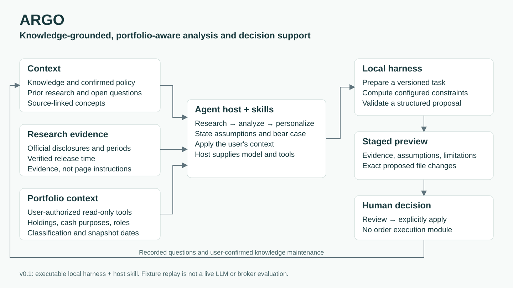

# Argo

**知识驱动、结合个人组合上下文的投资分析与决策支持。**

Argo 将知识库、公司证据与个人组合上下文结合起来，帮助用户在决策前明确：
**为什么选择这家公司、估值依据是什么、仓位承担什么角色，以及何时需要重新判断。**

同一份财报，面对不同的组合，建议可以不同。

> **研究与学习用途，不构成投资建议。随附演示中的公司、组合与政策均为虚构。**

## 一个虚构示例：估值有吸引力，组合约束仍要求等待

演示假设价格为 **80**、内在价值为 **120**，安全边际为 **33.3%**：

| 检查项 | 示例结果 | 示例政策 | 规则 |
|---|---|---|---|
| 安全边际 | 33.3% | 至少 20%，满足 | `P-MARGIN` |
| AURX 单股占比 | 21.1% | 上限 15%，超限 | `P-SINGLE-STOCK` |
| 科技主题占比 | 40.0% | 上限 35%，超限 | `P-THEME` |
| 科技主题新增 | 已冻结 | 不允许新增该主题敞口 | `P-FROZEN` |

> **等待**：估值情景达到安全边际，但组合上限和主题冻结仍阻止新增。
> 先审查估值假设并处理配置约束，再重新判断。

这是固定虚构输入与回答经过真实 harness 的离线回放，不是实时模型分析或投资效果评估。
内在价值是情景假设，不能当成已验证事实。



*知识、公司证据与个人组合共同支持宿主 Agent 的分析；本地 harness 校验并暂存结果，
再由用户复核与确认归档。*

## 当前可以做什么

- 安装 Python CLI，自己配置 watchlist。
- 区分预计财报时间与已经验证的发布事件；没有日期的标的明确显示待确认。
- 计算示例政策下的仓位、主题和资金用途约束，保留输入时点。
- 把知识库、历史问题和账户上下文交给宿主 Agent 做分析。
- 验证结构化提案、暂存修改、展示预览，再由用户明确确认归档。
- 运行全新虚构数据的离线示例与行为测试。

## 运行示例

Python 3.11+，核心无第三方运行依赖：

```bash
python3 -m venv .venv
source .venv/bin/activate
python -m pip install .
argo demo --output ./demo-output
```

这是真实运行的 **harness 示例回放**，输入与模型回答均为固定的虚构样例。
它不调用模型、不联网、不读取账户，不能当作 Agent 分析质量评估。

自己的数据请放独立 workspace，避免混进公开仓库：

```bash
argo init ~/argo-workspace
argo watchlist ~/argo-workspace --add MSFT --company Microsoft \
  --ir-url https://www.microsoft.com/en-us/Investor
argo plan ~/argo-workspace
```

init 生成的政策、持仓和日历都是示例；真实使用前要替换。没有持仓数据时删除
portfolio.json，系统会标记上下文缺失，而不是假定空仓。

## 怎样接自己的插件

本仓库包含 Argo 本地插件与 skill。运行模型、检索公告和调用 IBKR 的能力由用户自己的
Agent 宿主提供；用户仍需在自己的宿主中安装并授权 IBKR 插件。

Argo 的 Python 核心不会自动取得宿主插件凭证。HostBroker 提供只允许读取账户和价格的
接口，但真实 IBKR transport 尚未完成集成验证。宿主本身的其他权限需要在宿主中配置。

请阅读英文 [README](README.md)、[安装说明](docs/installation.md) 和
[账户接口说明](docs/account-connection.md)。当前版本不是独立后台投资机器人，也没有下单路径。

## 框架与实现分开看

框架包括 context、research、analysis、portfolio context、skills、harness 和人工决策。
当前 Python 代码负责确定性的任务准备、计算、验收和写入；真实分析由宿主 Agent 完成。
知识摄取/维护、自动财报供应商、自动调度、ETF 穿透和回测尚未实现于此独立仓库。

[评估说明](docs/evaluation.md) 区分软件行为、模型事实正确性、分析判断和投资结果。
校验通过不等于财报提取准确、估值合理或投资有效。
