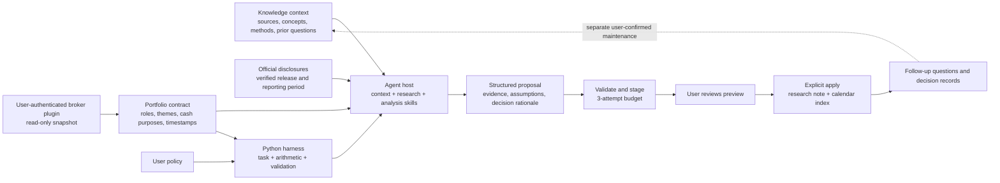

# Architecture

## Ownership

The host supplies model execution, discovery of its existing tools, web research,
authentication and scheduling. Argo owns user configuration, deterministic portfolio
context, proposal acceptance, staging, filesystem writes through its interface,
receipts and traces. The model's internal reasoning is not recorded or required.

`HostBroker(call_tool)` is the seam for a host-authenticated plugin. Its allowlist is
code-enforced **within that wrapper**. It does not restrict tools the host exposes by
other paths. The bundled skill is instruction-based orchestration, not an independent
agent runtime. No LLM or broker credentials are collected by the CLI.

## Task lifecycle

1. **Plan** verifies calendar state. `expected_at` cannot establish a released event.
2. **Prepare** captures exact input hashes, selected knowledge, event identity and
   existing output hashes. It computes portfolio context in Python.
3. **Research/analyze** happens in the host. It verifies sources and generates a proposal.
4. **Stage** validates IDs, timestamps, evidence references, known knowledge links,
   exact supported rule IDs and configured decision constraints. Failed attempts are
   recorded, and three failures stop that task's repair loop.
5. **Review** displays the report and exact changed-file map. No research output has
   been changed at this point.
6. **Apply** is an explicit operator command. It rechecks inputs and existing outputs,
   rejects symlink paths, writes only its predefined research note/calendar targets,
   then records an event receipt. Successful repeated apply is idempotent.

Each output file is replaced atomically. A multi-file commit is **not** a filesystem
transaction: interruption between writes can leave a partial commit. A write-ahead
journal identifies it; inspect and recover manually rather than blindly retrying.
Local locks serialize Argo operations but do not lock external editors. Hash checks
catch edits made before apply; they cannot stop an unrelated process editing files
between checks and replacement.

## Knowledge organization

The example library uses source-backed concepts and basename links. The task reads
selected notes and refuses unresolved links in the proposal. New knowledge, personal
beliefs and rule activation require a distinct maintenance workflow, not an earnings
report write. This release ships the read/context slice; it does not claim an automated
ingest/lint implementation or a vector/GraphRAG retrieval engine.

## Trust model

- The workspace owner, local executable and filesystem are trusted. A user with arbitrary
  local write access can change manifests or state; these are provenance records, not
  signed tamper-proof evidence.
- Staging controls writes **through Argo**. A host with unrestricted shell/filesystem
  access is not sandboxed by Argo and can bypass those tools. Use host permissions and
  a dedicated workspace as well as instructions.
- Web pages and filings are untrusted task data, never instructions to execute tools.
- An HTTPS URL and declared `official_ir` type do not authenticate source contents.
- A current broker snapshot can coexist with older classifications. Preserve both dates;
  do not describe every derived exposure as real time.
- Rule IDs resolve to implemented template rules, not semantic entailment of the model's
  explanation. A source/claim mapping does not establish factual correctness.

## Why a single orchestrating host first?

Context, research, analysis and portfolio reasoning have different responsibilities
without requiring separate simulated personas. Keep the first vertical slice inspectable.
Additional model workers are warranted only if measured quality or latency justifies them.
